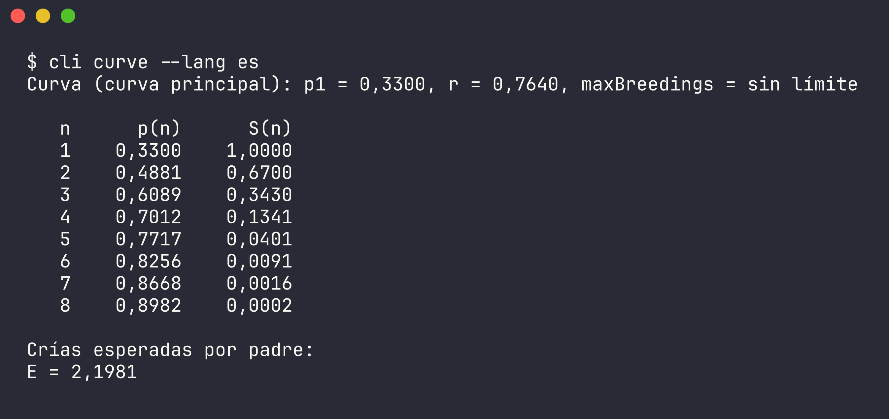
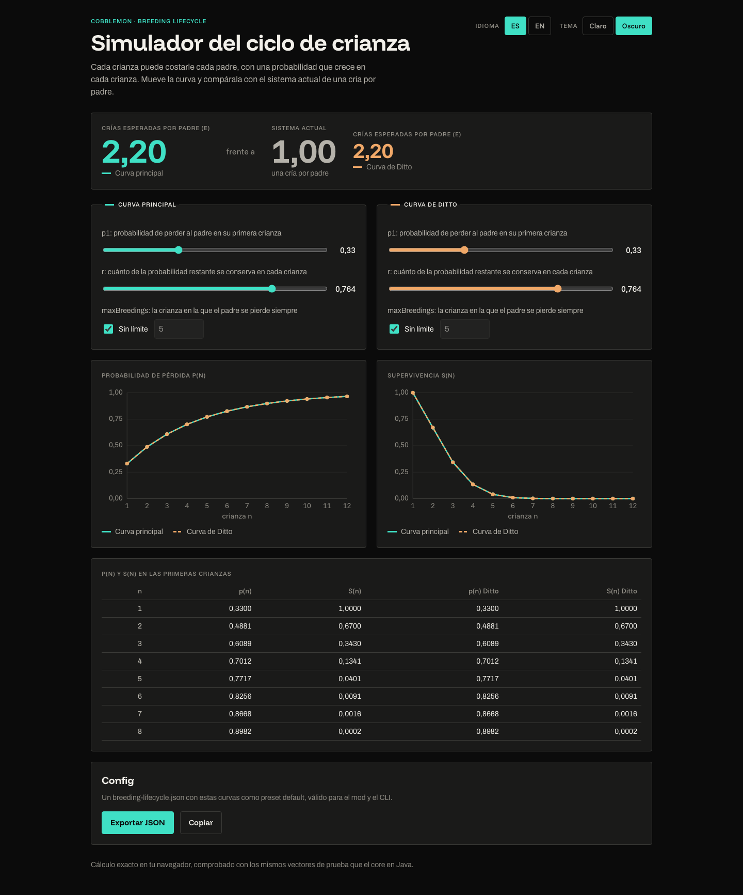

[English](README.md)

# Breeding Lifecycle

Un mod de Cobblemon solo para el servidor en el que cada crianza tiene una probabilidad creciente, por padre, de
perder a cada padre, en lugar de consumir siempre a los dos. Trae una API Java de una sola llamada para una
guardería existente, una guardería de referencia para probarlo, un simulador de línea de comandos y un simulador web
estático.

## Qué es
La crianza siempre produce la cría. Después cada padre tira por su cuenta: con la curva por defecto se pierde con un
33 % de probabilidad en su primera crianza, y luego 49 %, 61 %, 70 % y 77 % en las siguientes. En promedio un padre
da `E = 2,20` crías antes de perderse, frente a `1` en un sistema que consume siempre a los dos padres.

## Cómo funciona
En la crianza número `n` de un padre, la probabilidad de perderlo es `p(n) = 1 − (1 − p1) · r^(n−1)`, y llega a `1`
en `maxBreedings` si está fijado. El preset por defecto es `p1 = 0.33`, `r = 0.764`, sin límite, y un Ditto tiene su
propia curva con los mismos valores. Cada Pokémon lleva su propio contador de crianzas, así que la probabilidad lo
acompaña en el PC y en los intercambios. La supervivencia `S(n)`, las crías esperadas `E = Σ S(n)` y los vectores de
prueba compartidos están en [docs/formula.md](docs/formula.md) (en inglés).

## El mod
- **Solo servidor.** Los jugadores no instalan nada; los textos se traducen en el servidor al inglés o al español,
  según el idioma de cada cliente.
- **Versiones** (fijadas en [gradle.properties](gradle.properties), con su fuente en
  [docs/research/modpack-versions.md](docs/research/modpack-versions.md)): Minecraft 1.21.1, Java 21,
  Cobblemon `1.7.3+1.21.1`, Fabric Loader 0.19.2, Fabric API `0.116.11+1.21.1`, Fabric Language Kotlin
  `1.13.11+kotlin.2.3.21`.
- **Instalación.** Compila el jar con `./gradlew :mod:build` y copia `mod/build/libs/mod-0.1.0.jar` en la carpeta
  `mods/` del servidor, junto a Fabric API, Fabric Language Kotlin y Cobblemon. Server Translations API va incluida.
- **Configuración.** `config/breeding-lifecycle.json` se escribe con los valores por defecto en el primer arranque.
  Contiene los presets, los overrides campo por campo y los interruptores de la guardería de referencia, del
  adaptador de `COLLECT_EGG` y del log de auditoría (`logs/breeding-lifecycle/audit.jsonl`). Cada valor inválido se
  informa con su campo, su valor y su rango; ver [docs/configuration.md](docs/configuration.md).
- **Comandos.**

| Comando | Quién | Qué hace |
|---|---|---|
| `/breedinglifecycle reload` | operadores (nivel 2) | Relee la config; si es inválida conserva la anterior y lista cada error. `/reload` de vanilla hace lo mismo. |
| `/breedinglifecycle info <1-6>` | cualquier jugador | Especie, crianzas hechas y probabilidad de pérdida de la próxima crianza para ese slot del equipo. |
| `/breedinglifecycle curve` | cualquiera | `n`, `p(n)`, `S(n)` y `E` de las curvas activas, la principal y la de Ditto. |

## Integrar con una llamada
La guardería propia de un servidor, u otro mod, cría primero y después llama:

```java
BreedingResult result = BreedingLifecycle.evaluate(parentA, parentB);
if (!result.parentA().survives()) {
    // retira parentA de donde lo guarde tu guardería
}
```

`evaluate` tira por cada padre con su propio contador y su propia curva, suma una crianza a los dos contadores,
escribe las líneas de auditoría y devuelve `n`, `p`, la tirada y `survives()` por padre. Solo se llama en el hilo del
servidor, y quien llama retira a los padres perdidos. Para que una crianza resista una caída, guarda padres y crías
en un solo almacén persistente y haz la crianza entera en un tick del servidor. Los mods de crianza que disparan el
evento `COLLECT_EGG` de Cobblemon con los padres reales se pueden cubrir con `eggEventAdapter.enabled`. Contrato,
ejemplo y límites: [docs/integration.md](docs/integration.md).

## Guardería de referencia
Una guardería pequeña para probar la curva en el juego, desactivada por defecto porque crea Pokémon gratis
(`referenceDaycare.enabled`). `/daycare deposit <slot>` mete un Pokémon del equipo (dos plazas por jugador),
`/daycare breed` los cría, `/daycare status` muestra padres, crianzas, la próxima probabilidad de pérdida y las crías
pendientes, y `/daycare withdraw` devuelve todo al equipo o al PC. La compatibilidad sigue las reglas de Cobbreeding;
la cría es la forma base de la especie de la madre (o del padre que no es Ditto), a nivel 1, sin huevos, tiempos ni herencia. Ver
[docs/integration.md](docs/integration.md#reference-daycare) y
[0009](docs/decisions/0009-reference-daycare.md).

## CLI
Un simulador de terminal sobre el mismo núcleo de reglas y el mismo archivo de config: `curve` imprime la tabla y
`E`, `simulate` corre un Monte Carlo con semilla y `compare` pone la curva al lado del sistema actual. `--lang es|en`,
`--config <archivo>` y `--ditto` sirven en todos los comandos.

```bash
./gradlew :cli:installDist
cli/build/install/cli/bin/cli curve --lang es
```



Opciones y códigos de salida: [docs/cli.md](docs/cli.md).

## Web
Una página estática sin backend: sliders de `p1`, `r` y `maxBreedings` para la curva principal y la de Ditto,
gráficas de `p(n)` y `S(n)`, `E` frente a `1,00` y **Exportar JSON**, que da una config que el mod y el CLI aceptan.
En español e inglés, con tema claro y oscuro. No está desplegada; se compila y se sirve `web/dist` desde cualquier
hosting estático, con `WEB_BASE` si vive bajo una subruta:

```bash
npm --prefix web ci
WEB_BASE=/breeding/ npm --prefix web run build
```



Detalles: [docs/web.md](docs/web.md).

## Desarrollo
Hace falta JDK 21; `./scripts/check.sh` lo encuentra y corre la suite entera: tests unitarios, Spotless, Checkstyle,
el control de largo de comentarios, los GameTests del mod en un servidor headless y luego los tests y el build de la
web.

| Ruta | Qué |
|---|---|
| `core` | Reglas en Java puro: curva, tiradas, RNG con semilla, simulador, parseo y validación de la config. |
| `cli` | Simulador picocli sobre `core`. |
| `mod` | Mod Fabric solo servidor sobre `core` y Cobblemon, con la guardería de referencia y los GameTests. |
| `web` | Simulador estático en Vite + TypeScript. |
| `test-vectors` | Casos de la curva compartidos por los tests de `core` y de `web`. |
| `build-logic` | Plugins de convención de Gradle y controles del repo. |

Diseño: [docs/architecture.md](docs/architecture.md). Decisiones: [docs/decisions/](docs/decisions/).

## Capturas
Cada captura, qué muestra y si funciona: [docs/screenshots/INDEX.md](docs/screenshots/INDEX.md). Las del juego
(`/daycare status`, `/breedinglifecycle info` y una pérdida) aún no están tomadas; cómo tomarlas está en
[docs/screenshots/TODO.md](docs/screenshots/TODO.md).
