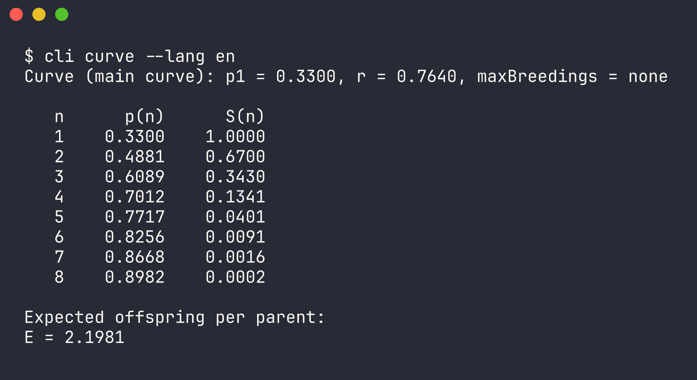
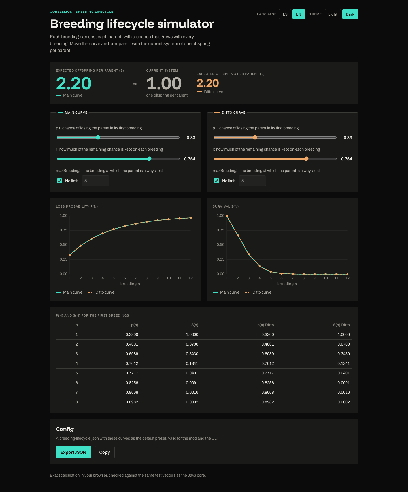
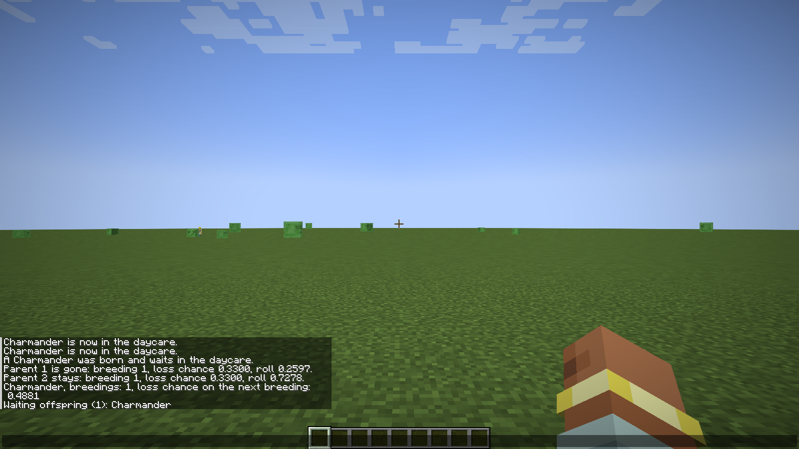
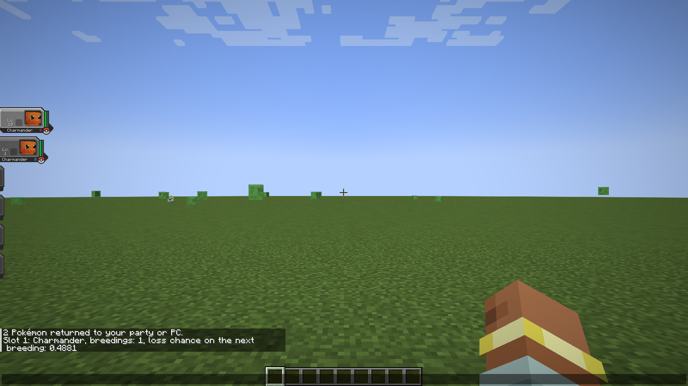
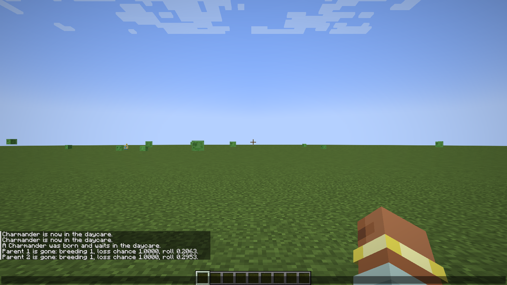
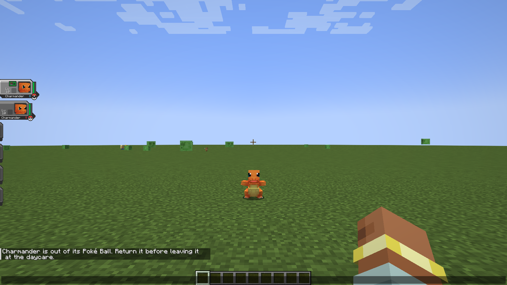

[Español](README.es.md)

# Breeding Lifecycle

A server-only Cobblemon mod where every breeding has a growing, per-parent chance of losing each parent, instead of
always consuming both. It ships with a one-call Java API for an existing daycare, a reference daycare to try it, a
command-line simulator and a static web simulator.

## What it is
Breeding always produces the offspring. Afterwards each parent rolls on its own: with the default curve it is lost
with a 33 % chance on its first breeding, then 49 %, 61 %, 70 % and 77 % on the following ones. On average a parent
gives `E = 2.20` offspring before it is lost, against `1` in a system that always consumes both parents.

## How it works
For a parent's `n`-th breeding the loss chance is `p(n) = 1 − (1 − p1) · r^(n−1)`, reaching `1` at `maxBreedings`
when one is set. The default preset is `p1 = 0.33`, `r = 0.764`, no limit, and a Ditto has its own curve with the
same defaults. Each Pokémon carries its own breeding counter, so the chance follows it through the PC and trades.
The survival `S(n)`, the expected offspring `E = Σ S(n)` and the shared test vectors are in
[docs/formula.md](docs/formula.md).

## The mod
- **Server only.** Players install nothing; text is translated on the server into English or Spanish, following
  each client's language.
- **Versions** (pinned in [gradle.properties](gradle.properties), source in
  [docs/research/modpack-versions.md](docs/research/modpack-versions.md)): Minecraft 1.21.1, Java 21,
  Cobblemon `1.7.3+1.21.1`, Fabric Loader 0.19.2, Fabric API `0.116.11+1.21.1`, Fabric Language Kotlin
  `1.13.11+kotlin.2.3.21`.
- **Install.** Build the jar with `./gradlew :mod:build` and copy `mod/build/libs/mod-0.1.0.jar` into the server's
  `mods/` folder, next to Fabric API, Fabric Language Kotlin and Cobblemon. Server Translations API is bundled.
- **Configure.** `config/breeding-lifecycle.json` is written with the defaults on first start. It holds presets,
  field-by-field overrides and the switches for the reference daycare, the `COLLECT_EGG` adapter and the audit log
  (`logs/breeding-lifecycle/audit.jsonl`). Every invalid value is reported with its field, value and range; see
  [docs/configuration.md](docs/configuration.md).
- **Commands.**

| Command | Who | Does |
|---|---|---|
| `/breedinglifecycle reload` | operators (level 2) | Re-reads the config; an invalid one keeps the previous settings and lists every error. Vanilla `/reload` does the same. |
| `/breedinglifecycle info <1-6>` | any player | Species, breedings done and the loss chance of the next breeding for that party slot. |
| `/breedinglifecycle curve` | anyone | `n`, `p(n)`, `S(n)` and `E` for the active main and Ditto curves. |

## Integrate with one call
A server's own daycare, or another mod, breeds first and then calls:

```java
BreedingResult result = BreedingLifecycle.evaluate(parentA, parentB);
if (!result.parentA().survives()) {
    // remove parentA from wherever your daycare keeps it
}
```

`evaluate` rolls each parent with its own counter and curve, adds one breeding to both counters, writes the audit
lines and returns `n`, `p`, the roll and `survives()` per parent. It runs on the server thread only, and the caller
removes the lost parents. For a breeding that survives a crash, keep parents and offspring in one persistent store
and do the whole breeding in one server tick. Breeding mods that fire Cobblemon's `COLLECT_EGG` event with the real
parents can be covered with `eggEventAdapter.enabled` instead. Contract, example and limits:
[docs/integration.md](docs/integration.md).

## Reference daycare
A small daycare to try the curve in game, off by default because it creates Pokémon for free
(`referenceDaycare.enabled`). `/daycare deposit <slot>` moves a party Pokémon in (two places per player),
`/daycare breed` breeds them, `/daycare status` shows parents, breedings, next loss chance and waiting offspring, and
`/daycare withdraw` returns everything to the party or the PC. Compatibility follows Cobbreeding's rules; the
offspring is the first stage of the mother's evolutionary line (or of the non-Ditto parent's) at level 1, with no eggs, timers or inheritance. See
[docs/integration.md](docs/integration.md#reference-daycare) and
[0009](docs/decisions/0009-reference-daycare.md).

## CLI
A terminal simulator on the same rules core and the same config file: `curve` prints the table and `E`, `simulate`
runs a seeded Monte Carlo, and `compare` puts the curve next to the current system. `--lang es|en`,
`--config <file>` and `--ditto` work on every command.

```bash
./gradlew :cli:installDist
cli/build/install/cli/bin/cli curve --lang en
```



Options and exit codes: [docs/cli.md](docs/cli.md).

## Web
A static page with no backend: sliders for `p1` and `r` and an optional `maxBreedings` for the main and Ditto curves, charts of
`p(n)` and `S(n)`, `E` against `1.00`, and **Export JSON** for a config the mod and the CLI accept. Spanish and
English, light and dark themes. It is not deployed; build it and serve `web/dist` from any static host, setting
`WEB_BASE` when it lives under a sub-path:

```bash
npm --prefix web ci
WEB_BASE=/breeding/ npm --prefix web run build
```



Details: [docs/web.md](docs/web.md).

## Development
JDK 21 is required; `./scripts/check.sh` finds it and runs the whole suite: unit tests, Spotless, Checkstyle, the
comment-length check, the mod's GameTests on a headless server, and then the web tests and build.

| Path | What |
|---|---|
| `core` | Rules in plain Java: curve, rolls, seeded RNG, simulator, config parsing and validation. |
| `cli` | picocli simulator on `core`. |
| `mod` | Server-only Fabric mod on `core` and Cobblemon, with the reference daycare and the GameTests. |
| `web` | Static Vite + TypeScript simulator. |
| `test-vectors` | Curve cases shared by the `core` and `web` tests. |
| `build-logic` | Gradle convention plugins and repo checks. |

Design: [docs/architecture.md](docs/architecture.md). Decisions: [docs/decisions/](docs/decisions/).

## Screenshots
Every screenshot, what it shows and whether it works: [docs/screenshots/INDEX.md](docs/screenshots/INDEX.md). The
in-game ones come from the development client (Cobblemon and this mod, without the pack's other mods) and are
regenerated with `scripts/ingame-screenshots.sh auto` ([docs/ingame-screenshots.md](docs/ingame-screenshots.md)).

`/daycare status` after one breeding on the default curve:



`/breedinglifecycle info` of a parent that came back:



A loss with `p1 = 1.0`, both parents gone:



`/daycare deposit` refused while the Pokémon is out of its Poké Ball:


